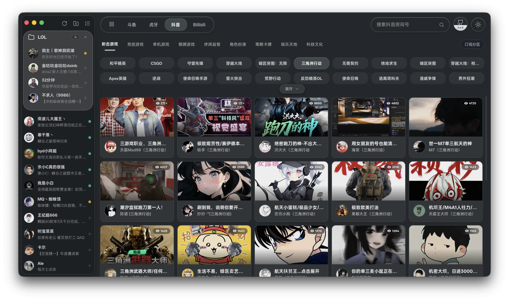
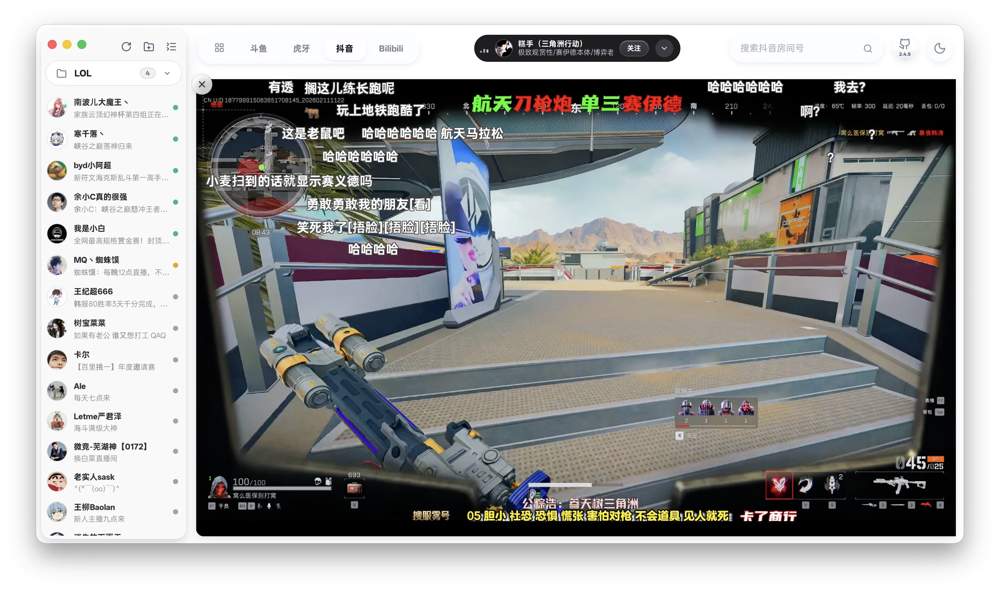

<div align="center">
  
  <h1>DTV</h1>
  <p>基于 Wails v3 的跨平台斗鱼、虎牙、抖音、bilibili直播桌面客户端</p>
</div>

<p align="center">
  <a href="https://apps.microsoft.com/detail/9mt8kdt169xf?referrer=appbadge&mode=direct">
    
  </a>
</p>

## 说明

> 安卓版本：[`dtv_mobile`](https://github.com/chen-zeong/dtv_mobile)

1. 本项目基于 Wails v3 开发，体积小，占用率低，实测可以在双核、4GB内存的电脑上流畅运行
2. 平台接口可能有访问频率限制，过于频繁的请求会触发验证码校验，建议合理使用搜索功能
3. 本项目仅供学习编程目的使用，未进行任何逆向工程
4. 本项目所有的直播版权都归属各个平台

### 支持平台

| 平台       | 直播流 | 弹幕  | 搜索   |
| -------- | --- | --- | ---- |
| 斗鱼       | ✅   | ✅   | ✅    |
| 虎牙       | ✅   | ✅   | ✅    |
| bilibili | ✅   | ✅   | ✅    |
| 抖音       | ✅   | ✅   | 仅房间号 |

## 功能

- 📺 平台支持：支持斗鱼、虎牙、bilibili、抖音直播
- 💬 弹幕显示：实时显示直播间弹幕，只显示聊天弹幕，不显示礼物等其他类型弹幕
- ⭐ 主播收藏：支持收藏喜欢的主播，支持收藏列表手动拖拽排序
- 🔁 数据同步：支持局域网一键同步或者json文件手动同步，可以与桌面端或者移动端同步数据
- 📋 支持平台：Mac(Intel+Arm)，Windows(Win7需要自行安装Webview2)，Linux(包括Ubuntu和各类发行版)
- 🌓 主题切换：支持明暗主题切换

## 软件截图


<div align="center">
  <p>日间模式</p>
  
</div>

<br>

<div align="center">
  <p>夜间模式</p>
  
</div>

<br>

<div align="center">
  <p>日间模式 - 播放器页面</p>
  
</div>

<br>

## 安装方式

可以在 [release](https://github.com/chen-zeong/DTV/releases) 目录下载对应系统的安装包, 也可以通过源码编译安装

## 编译

```bash
# 前置：Go 1.26+、Node 20+、pnpm，以及 Wails v3 CLI
go install github.com/wailsapp/wails/v3/cmd/wails3@v3.0.0

# 克隆项目
git clone https://github.com/chen-zeong/DTV.git
cd DTV

# 安装依赖
cd frontend && pnpm install && cd ..

# 开发调试
wails3 dev

# 打包构建
wails3 build
wails3 package

# macOS：arm64 / Intel 两个版本
wails3 task darwin:package ARCH=arm64
wails3 task darwin:create:dmg
wails3 task darwin:package ARCH=amd64
wails3 task darwin:create:dmg

# Windows：先构建 exe，再用 WiX v3 打包 MSI
wails3 build SIGN_ENABLED=false
wails3 task windows:msi WIX_BIN="C:\path\to\wix314"
```

## 参考

- 斗鱼直播流获取参考了 [@wbt5/real-url](https://github.com/wbt5/real-url)  
- 抖音弹幕参考了[@saermart/DouyinLiveWebFetcher](https://github.com/saermart/DouyinLiveWebFetcher)
- 虎牙参考了https://github.com/liuchuancong/pure_live https://github.com/ihmily/DouyinLiveRecorder
- b站弹幕参考了https://github.com/xfgryujk/blivedm
